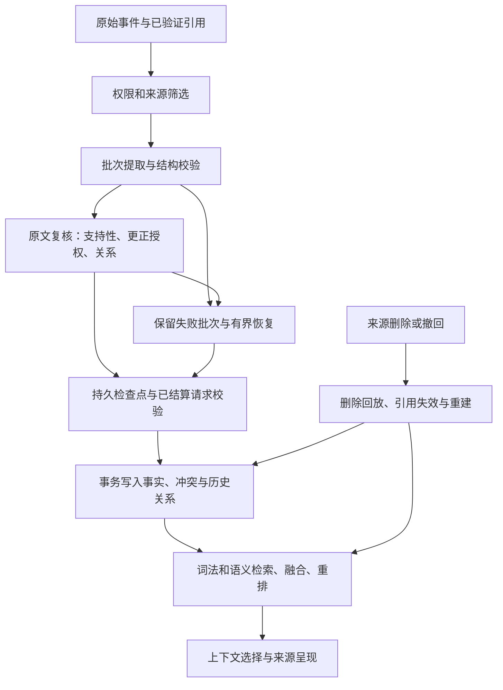

# 结构与源码阅读地图

实现来源：Companion Core `30628cff61d6642d6ababf833d6432cd83695c0f`。
下列路径相对于 `reference/upstream/`。这部分是可阅读、可对照的原生源码快照；
实际启动完整 Core 时应使用对应主仓库提交和依赖。

| 阅读顺序 | 文件 | 主要职责 |
| --- | --- | --- |
| 1 | `companion/contracts.py` | 严格候选、关系、更正和输出契约 |
| 2 | `companion/memory_authority.py`、`memory_references.py` | 主人/转述/文档的来源权限与引用 |
| 3 | `companion/memory_work.py` | 短引用、提取解析、原文复核、检查点与批次提交 |
| 4 | `companion/memory_recovery.py` | 失败批次保留、显式有界恢复和已结算请求复用 |
| 5 | `companion/memory.py`、`memory_control.py` | 事实写入、关系和控制入口 |
| 6 | `companion/memory_context.py`、`memory_projections.py` | 记忆选择及投影视图 |
| 7 | `companion/retrieval.py`、`reranker.py`、`turn_recall.py` | 混合检索、融合与原始回合召回 |
| 8 | `companion/context_selection.py`、`context_planner.py` | 可用上下文、来源组与长度边界 |
| 9 | `companion/erasure.py`、`privacy.py` | 删除、撤回和来源失效 |
| 10 | `companion/paid_budget.py`、`budget.py`、`store.py` | 费用状态、预算与持久事务 |
| 11 | `migrations/versions/`、`tests/test_*memory*.py` | 存储演进与回归行为证据 |

## 写入必须保持的条件

候选必须回到可使用的事件或引用，原文片段必须匹配，主体和说话者必须明确。
主人转述第三方经历不会把经历变成主人自己的事实，助手建议不会成为主人承诺。
权限在实际提交时重新检查，不能只依赖提取时的一次判定。

更正需要同时对齐原文授权、候选的 `update` 和正文所表达的替代关系。
普通矛盾应保留冲突；明确更正应记录被替代对象和历史。`same`、`conflicts`、
`replaces` 之间的引用必须有效，不能引用未来、未知、错误主体或错误来源类型。
只兼容可无损归一化的单元素 `same` 数组和单字段引用包装。

模型调用具有预算预留和结算状态。只有 `SETTLED` 才可消费结果；`UNKNOWN`
需要保留不确定性，不得自动重放。提取—复核的分歧携带反馈进入原有有界修正流程；
仍失败则保留批次，后续批次不会覆盖失败证据。

原始来源删除后，记忆、引用、检查点与检索投影都要遵守删除回放。
不能只删向量而保留能再次生成事实的旧检查点或候选。

## Python 包的边界

`src/companion_memory/` 由 `scripts/sync_upstream.py` 对原生 AST 提取生成：
契约、短引用、JSON 括号修复、提取解析、关系一致性检查、词法排序和 RRF 融合。
生成器还提取三个原生运行提示词。`--verify` 会重新生成并逐字节比较。

`resolve_review` 接收的是**已经通过来源权限校验**的候选与目录。
它检查返回关系，不能独自证明原文授权或执行费用结算。`require_settled`
检查存储中的状态，调用者仍负责真正的供应商记账和预算事务。

`examples/sqlite_demo.py` 用固定输出演示单个初始主人事实：
只有原文匹配且请求已结算才能写入；来源被删时 SQLite 外键级联删除事实。
完整历史更正、权限、并发、失败恢复和删除回放，应参照原生实现及测试接入宿主项目。
示例不宣称已经实现这些生产能力。
